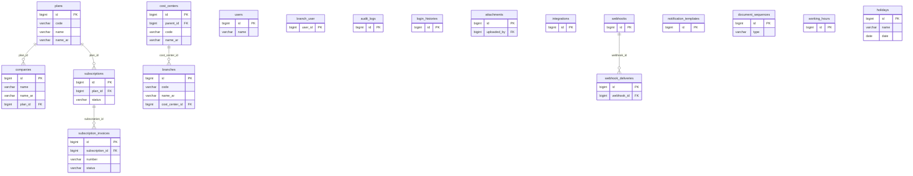
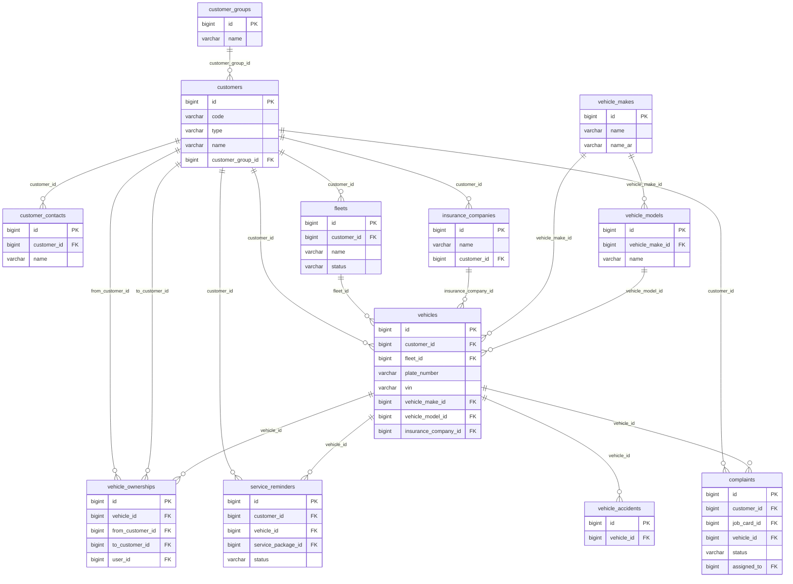
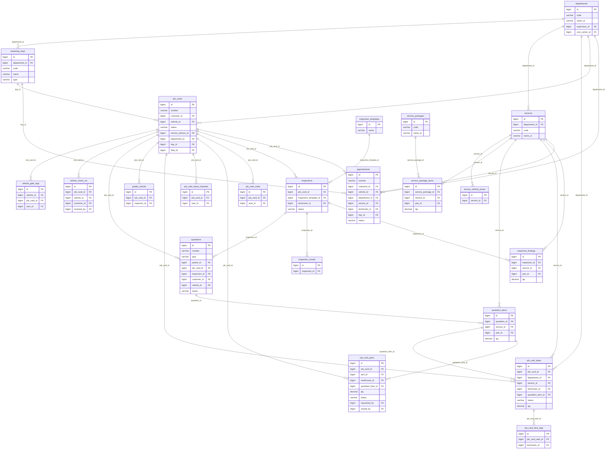
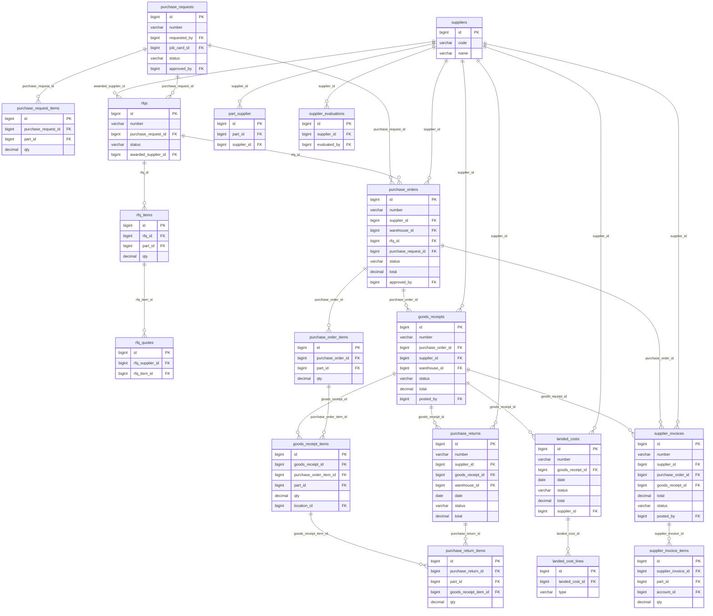
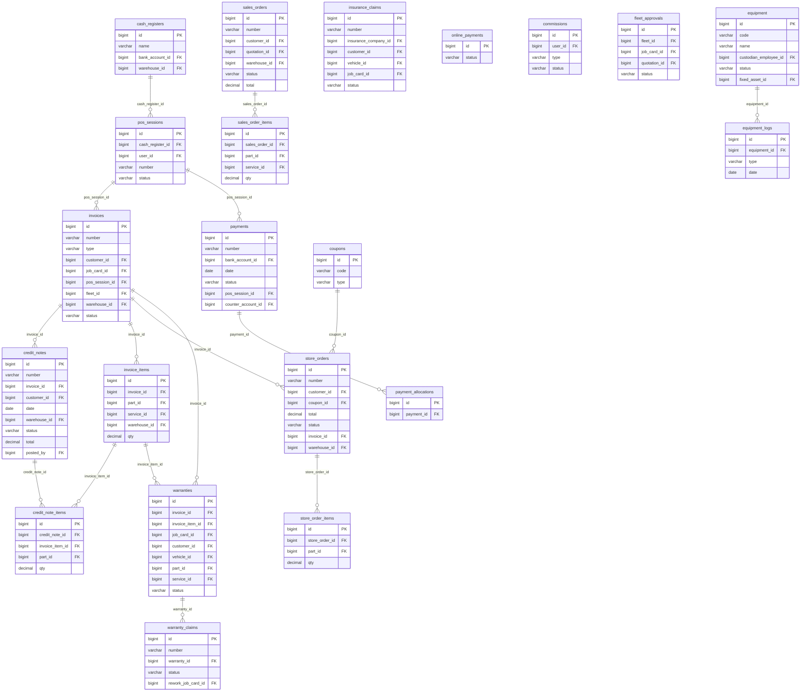
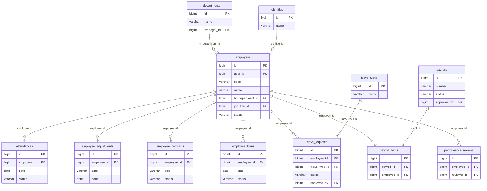

# Entity Relationship Diagram

Generated from the live database schema (159 tables, 444 foreign keys). Each diagram shows one domain with its key columns and foreign keys; links to `companies`, `branches` and `users` are omitted for readability: **every business table carries `company_id`** (tenant isolation, indexed) and most carry `branch_id` and `created_by`.

Conventions: money columns are `DECIMAL(15,3)` (OMR), unit costs `DECIMAL(15,4)`, quantities `DECIMAL(14,3)`; document numbers are unique per company (`PREFIX-YYYY-000001`).

## Platform, tenancy & security

## Customers & vehicles

Cross-domain links: `complaints.job_card_id` → `job_cards`, `service_reminders.service_package_id` → `service_packages`.

## Workshop

Cross-domain links: `appointments.customer_id` → `customers`, `appointments.vehicle_id` → `vehicles`, `departments.cost_center_id` → `cost_centers`, `inspection_findings.part_id` → `parts`, `job_cards.customer_id` → `customers`, `job_cards.fleet_id` → `fleets`, `job_cards.vehicle_id` → `vehicles`, `job_card_parts.part_id` → `parts`, `job_card_parts.warehouse_id` → `warehouses`, `quotations.customer_id` → `customers`, `quotations.vehicle_id` → `vehicles`, `quotation_items.part_id` → `parts`, `service_package_items.part_id` → `parts`, `vehicle_check_ins.customer_id` → `customers`, `vehicle_check_ins.vehicle_id` → `vehicles`, `vehicle_gate_logs.vehicle_id` → `vehicles`.

## Inventory & dismantling

```mermaid
erDiagram
    parts {
        bigint id PK
        varchar sku
        varchar name_ar
        bigint part_category_id FK
        bigint brand_id FK
        bigint default_supplier_id FK
    }
    part_categories {
        bigint id PK
        bigint parent_id FK
        varchar code
        varchar name_ar
    }
    brands {
        bigint id PK
        varchar name
    }
    part_alternatives {
        bigint id PK
        bigint part_id FK
        varchar number
        varchar type
    }
    part_compatibilities {
        bigint id PK
        bigint part_id FK
        bigint vehicle_make_id FK
        bigint vehicle_model_id FK
    }
    warehouses {
        bigint id PK
        varchar code
        varchar name
        varchar type
    }
    warehouse_locations {
        bigint id PK
        bigint warehouse_id FK
        varchar code
        varchar name
    }
    stock_levels {
        bigint id PK
        bigint part_id FK
        bigint warehouse_id FK
        bigint location_id FK
    }
    stock_batches {
        bigint id PK
        bigint part_id FK
        bigint warehouse_id FK
    }
    stock_movements {
        bigint id PK
        bigint warehouse_id FK
        bigint part_id FK
        varchar type
        decimal qty
        bigint user_id FK
    }
    stock_transfers {
        bigint id PK
        varchar number
        bigint from_warehouse_id FK
        bigint to_warehouse_id FK
        varchar status
        bigint received_by FK
    }
    stock_transfer_items {
        bigint id PK
        bigint stock_transfer_id FK
        bigint part_id FK
        decimal qty
    }
    stock_counts {
        bigint id PK
        varchar number
        bigint warehouse_id FK
        varchar type
        varchar status
        bigint posted_by FK
    }
    stock_adjustments {
        bigint id PK
        varchar number
        bigint warehouse_id FK
        date date
        varchar status
        bigint posted_by FK
    }
    stock_adjustment_items {
        bigint id PK
        bigint stock_adjustment_id FK
        bigint part_id FK
        decimal qty
    }
    stock_count_items {
        bigint id PK
        bigint stock_count_id FK
        bigint part_id FK
    }
    dismantled_vehicles {
        bigint id PK
        varchar number
        varchar vin
        bigint vehicle_make_id FK
        bigint vehicle_model_id FK
        bigint supplier_id FK
        bigint paid_from_bank_account_id FK
        bigint warehouse_id FK
        varchar status
    }
    dismantled_parts {
        bigint id PK
        bigint dismantled_vehicle_id FK
        bigint part_id FK
        varchar name
        bigint warehouse_id FK
        bigint location_id FK
        varchar status
    }
    dismantled_scraps {
        bigint id PK
        bigint dismantled_vehicle_id FK
        date date
        bigint bank_account_id FK
    }
    dismantled_vehicles ||--o{ dismantled_parts : "dismantled_vehicle_id"
    warehouse_locations ||--o{ dismantled_parts : "location_id"
    parts ||--o{ dismantled_parts : "part_id"
    warehouses ||--o{ dismantled_parts : "warehouse_id"
    dismantled_vehicles ||--o{ dismantled_scraps : "dismantled_vehicle_id"
    warehouses ||--o{ dismantled_vehicles : "warehouse_id"
    brands ||--o{ parts : "brand_id"
    part_categories ||--o{ parts : "part_category_id"
    parts ||--o{ part_alternatives : "part_id"
    parts ||--o{ part_compatibilities : "part_id"
    warehouses ||--o{ stock_adjustments : "warehouse_id"
    parts ||--o{ stock_adjustment_items : "part_id"
    stock_adjustments ||--o{ stock_adjustment_items : "stock_adjustment_id"
    parts ||--o{ stock_batches : "part_id"
    warehouses ||--o{ stock_batches : "warehouse_id"
    warehouses ||--o{ stock_counts : "warehouse_id"
    parts ||--o{ stock_count_items : "part_id"
    stock_counts ||--o{ stock_count_items : "stock_count_id"
    warehouse_locations ||--o{ stock_levels : "location_id"
    parts ||--o{ stock_levels : "part_id"
    warehouses ||--o{ stock_levels : "warehouse_id"
    parts ||--o{ stock_movements : "part_id"
    warehouses ||--o{ stock_movements : "warehouse_id"
    warehouses ||--o{ stock_transfers : "from_warehouse_id"
    warehouses ||--o{ stock_transfers : "to_warehouse_id"
    parts ||--o{ stock_transfer_items : "part_id"
    stock_transfers ||--o{ stock_transfer_items : "stock_transfer_id"
    warehouses ||--o{ warehouse_locations : "warehouse_id"
```

Cross-domain links: `dismantled_scraps.bank_account_id` → `bank_accounts`, `dismantled_vehicles.paid_from_bank_account_id` → `bank_accounts`, `dismantled_vehicles.supplier_id` → `suppliers`, `dismantled_vehicles.vehicle_make_id` → `vehicle_makes`, `dismantled_vehicles.vehicle_model_id` → `vehicle_models`, `parts.default_supplier_id` → `suppliers`, `part_compatibilities.vehicle_make_id` → `vehicle_makes`, `part_compatibilities.vehicle_model_id` → `vehicle_models`.

## Purchasing

Cross-domain links: `goods_receipts.warehouse_id` → `warehouses`, `goods_receipt_items.location_id` → `warehouse_locations`, `goods_receipt_items.part_id` → `parts`, `part_supplier.part_id` → `parts`, `purchase_orders.warehouse_id` → `warehouses`, `purchase_order_items.part_id` → `parts`, `purchase_requests.job_card_id` → `job_cards`, `purchase_request_items.part_id` → `parts`, `purchase_returns.warehouse_id` → `warehouses`, `purchase_return_items.part_id` → `parts`, `rfq_items.part_id` → `parts`, `rfq_quotes.rfq_supplier_id` → `rfq_suppliers`, `supplier_invoice_items.account_id` → `accounts`, `supplier_invoice_items.part_id` → `parts`.

## Sales & POS

Cross-domain links: `cash_registers.bank_account_id` → `bank_accounts`, `cash_registers.warehouse_id` → `warehouses`, `credit_notes.customer_id` → `customers`, `credit_notes.warehouse_id` → `warehouses`, `credit_note_items.part_id` → `parts`, `equipment.custodian_employee_id` → `employees`, `equipment.fixed_asset_id` → `fixed_assets`, `fleet_approvals.fleet_id` → `fleets`, `fleet_approvals.job_card_id` → `job_cards`, `fleet_approvals.quotation_id` → `quotations`, `insurance_claims.customer_id` → `customers`, `insurance_claims.insurance_company_id` → `insurance_companies`, `insurance_claims.job_card_id` → `job_cards`, `insurance_claims.vehicle_id` → `vehicles`, `invoices.customer_id` → `customers`, `invoices.fleet_id` → `fleets`, `invoices.job_card_id` → `job_cards`, `invoices.warehouse_id` → `warehouses`, `invoice_items.part_id` → `parts`, `invoice_items.service_id` → `services`, `invoice_items.warehouse_id` → `warehouses`, `payments.bank_account_id` → `bank_accounts`, `payments.counter_account_id` → `accounts`, `sales_orders.customer_id` → `customers`, `sales_orders.quotation_id` → `quotations`, `sales_orders.warehouse_id` → `warehouses`, `sales_order_items.part_id` → `parts`, `sales_order_items.service_id` → `services`, `store_orders.customer_id` → `customers`, `store_orders.warehouse_id` → `warehouses`, `store_order_items.part_id` → `parts`, `warranties.customer_id` → `customers`, `warranties.job_card_id` → `job_cards`, `warranties.part_id` → `parts`, `warranties.service_id` → `services`, `warranties.supplier_id` → `suppliers`, `warranties.vehicle_id` → `vehicles`, `warranty_claims.rework_job_card_id` → `job_cards`.

## Accounting

```mermaid
erDiagram
    accounts {
        bigint id PK
        bigint parent_id FK
        varchar code
        varchar name_ar
        varchar type
    }
    fiscal_years {
        bigint id PK
        varchar name
        varchar status
        bigint closed_by FK
    }
    fiscal_periods {
        bigint id PK
        bigint fiscal_year_id FK
        varchar name
        varchar status
        bigint closed_by FK
    }
    journal_entries {
        bigint id PK
        varchar number
        date date
        varchar status
        bigint posted_by FK
    }
    journal_lines {
        bigint id PK
        bigint journal_entry_id FK
        bigint account_id FK
        bigint cost_center_id FK
    }
    bank_accounts {
        bigint id PK
        bigint account_id FK
        varchar type
        varchar name
    }
    bank_reconciliations {
        bigint id PK
        bigint bank_account_id FK
        varchar status
    }
    expenses {
        bigint id PK
        varchar number
        date date
        bigint account_id FK
        bigint bank_account_id FK
        bigint supplier_id FK
        bigint cost_center_id FK
        decimal total
        varchar status
    }
    fund_transfers {
        bigint id PK
        varchar number
        date date
        bigint from_bank_account_id FK
        bigint to_bank_account_id FK
        varchar status
    }
    fixed_assets {
        bigint id PK
        varchar code
        varchar name
        bigint asset_account_id FK
        bigint accumulated_account_id FK
        bigint expense_account_id FK
        bigint cost_center_id FK
        varchar status
    }
    asset_depreciations {
        bigint id PK
        bigint fixed_asset_id FK
    }
    budgets {
        bigint id PK
        bigint fiscal_year_id FK
        varchar name
        varchar status
    }
    budget_lines {
        bigint id PK
        bigint budget_id FK
        bigint account_id FK
        bigint cost_center_id FK
    }
    tax_rates {
        bigint id PK
        varchar name
    }
    fixed_assets ||--o{ asset_depreciations : "fixed_asset_id"
    accounts ||--o{ bank_accounts : "account_id"
    bank_accounts ||--o{ bank_reconciliations : "bank_account_id"
    fiscal_years ||--o{ budgets : "fiscal_year_id"
    accounts ||--o{ budget_lines : "account_id"
    budgets ||--o{ budget_lines : "budget_id"
    accounts ||--o{ expenses : "account_id"
    bank_accounts ||--o{ expenses : "bank_account_id"
    fiscal_years ||--o{ fiscal_periods : "fiscal_year_id"
    accounts ||--o{ fixed_assets : "accumulated_account_id"
    accounts ||--o{ fixed_assets : "asset_account_id"
    accounts ||--o{ fixed_assets : "expense_account_id"
    bank_accounts ||--o{ fund_transfers : "from_bank_account_id"
    bank_accounts ||--o{ fund_transfers : "to_bank_account_id"
    accounts ||--o{ journal_lines : "account_id"
    journal_entries ||--o{ journal_lines : "journal_entry_id"
```

Cross-domain links: `budget_lines.cost_center_id` → `cost_centers`, `expenses.cost_center_id` → `cost_centers`, `expenses.supplier_id` → `suppliers`, `fixed_assets.cost_center_id` → `cost_centers`, `journal_lines.cost_center_id` → `cost_centers`.

## HR & payroll

## Other tables

`department_user`, `idempotency_keys`, `inspection_template_items`, `model_has_permissions`, `model_has_roles`, `notifications`, `notification_logs`, `permissions`, `promotions`, `rfq_suppliers`, `roles`, `role_has_permissions`, `service_ratings`, `warehouse_user`.

Framework tables: `migrations`, `sessions`, `cache`, `jobs`, `failed_jobs`, `password_reset_tokens`, `personal_access_tokens` (Sanctum), and Spatie permission tables (`roles`, `permissions`, `model_has_roles`, `model_has_permissions`, `role_has_permissions`, teams keyed by `company_id`).
